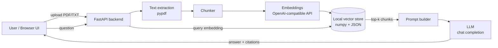

# 📄 DocChat — RAG Chatbot for Your Documents

Upload PDFs or text files and chat with them. DocChat uses **Retrieval-Augmented Generation (RAG)**: it splits documents into chunks, embeds them into a local vector store, retrieves the most relevant passages for each question and lets an LLM answer **with source citations**.

## ✨ Features
- Drag & drop upload of **PDF, TXT and Markdown** files
- Smart chunking with overlap and sentence-boundary cuts
- Local, persistent **numpy vector store** (cosine similarity) — no external DB needed
- Works with **any OpenAI-compatible API** (OpenAI, Azure OpenAI, Groq, OpenRouter, Ollama…)
- Answers grounded in your docs, with **inline citations** and an expandable sources panel
- Conversation memory (last turns sent as context)
- **Offline mock mode**: runs without an API key (hash embeddings + extractive answers) — great for demos & CI
- Clean single-page UI, REST API with auto-generated Swagger docs (`/docs`)
- Dockerized, sample documents auto-indexed on first run

## 🏗️ Architecture


## 🚀 Quick start

### Local
```bash
python -m venv .venv && source .venv/bin/activate
pip install -r requirements.txt
cp .env.example .env          # add OPENAI_API_KEY (or leave empty for mock mode)
uvicorn app.main:app --reload
```
Open http://localhost:8000 — API docs at http://localhost:8000/docs

### Docker
```bash
docker build -t docchat .
docker run -p 8000:8000 --env-file .env docchat
```

## 🔌 API
| Method | Endpoint | Description |
|---|---|---|
| GET | `/health` | Status, mode (mock/openai), document & chunk counts |
| GET | `/api/documents` | List indexed documents |
| POST | `/api/documents` | Upload a file (`multipart/form-data`, field `file`) |
| DELETE | `/api/documents/{name}` | Remove a document from the index |
| POST | `/api/chat` | `{"question": "...", "history": []}` → answer + sources |

## ⚙️ Configuration
See `.env.example`: `OPENAI_API_KEY`, `OPENAI_BASE_URL`, `CHAT_MODEL`, `EMBEDDING_MODEL`, `CHUNK_SIZE`, `CHUNK_OVERLAP`, `TOP_K`, `DATA_DIR`.

## 📸 Screenshots
> _Screenshots coming soon._
<!--  -->
<!--  -->

## 🛣️ Possible extensions
FAISS / Chroma / pgvector backend · auth & multi-tenant workspaces · streaming responses · Flutter mobile client · Slack/WhatsApp integration.

## 👤 Author
**Aziz Dilsiz** — Head of Tech, full-stack & AI developer (since 2007). Available for AI integration projects on Upwork.

## 📄 License
MIT — see [LICENSE](LICENSE).


## 🚀 Live demo deployment (free)
**Hugging Face Spaces (Docker):** create a Space with SDK *Docker*, then push this repo to it (`git push https://huggingface.co/spaces/<user>/docchat main`). The README front-matter configures port 7860.
**Render:** New → Web Service → this repo → runtime Docker, free plan (uses `render.yaml`).
Public-demo env vars: `PUBLIC_DEMO=1`, `MAX_UPLOAD_MB=2`, `MAX_DOCS=15`. No `OPENAI_API_KEY` ⇒ offline mock mode, zero cost.
